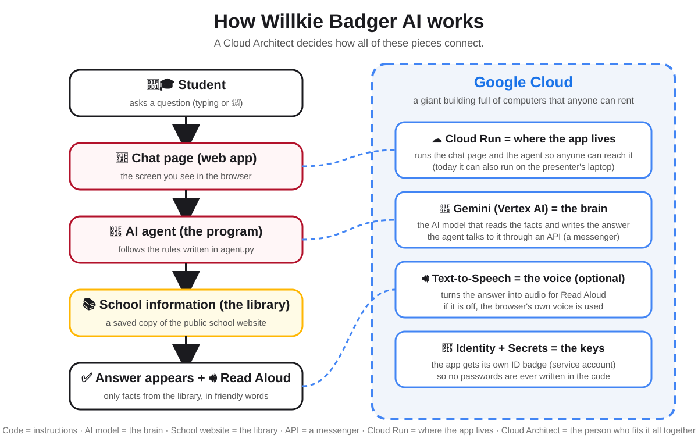

# Willkie Badger AI 🦡

A small, demo-ready AI chatbot for **Ed Willkie Middle School**, built for a
Career Day presentation about being a **Cloud Architect**.

It is built with Google's [Agent Development Kit (ADK)](https://google.github.io/adk-docs/)
and the [Agents CLI](https://google.github.io/agents-cli/), runs on a laptop or
on **Google Cloud Run**, answers from a **saved copy of the public school
website** (so it never invents school facts), and can **read answers aloud**.

> This is an AI demonstration for students in grades 6–8. It collects no names,
> accounts, chat history, or audio.

```
Student  →  Chat page  →  ADK agent  →  Gemini  →  Grounded EWMS information
                                 ↘ Google Cloud (Cloud Run, Vertex AI, Text-to-Speech)
```

---

## Career Day Demo

The shortest reliable path, in the order you will present it.

1. **Before the day** (once): follow *60-Second Demo Setup* below, then run
   `python scripts/career_day_check.py` and keep the printed answers as a backup.
2. **On the day**: open a terminal in this folder and run `make dev`
   (or the `uvicorn` command below). Open **http://localhost:8000**.
3. **Wow moment 1 – Code**: open `app/agent.py` in your editor (details below).
4. **Wow moment 2 – Cloud**: open `docs/architecture-student.svg` and, if you
   deployed, the Google Cloud console pages listed under *GCP resources to show*.
5. **Wow moment 3 – AI**: let students click a suggested question or type one,
   then click **🔊 Read Aloud** (next to the text box) to hear the latest answer. The
   button turns into **⏹ Stop** while audio plays. Flip **Auto voice** (top right)
   to on if you want every new answer read aloud automatically.
6. **The badger reacts**: the mascot in the top-right frame waves on load, listens
   when the mic is on, thinks while the library is searched, celebrates when it
   finds the answer, shrugs when the website has nothing, and talks while an
   answer is read aloud. Each reaction is a separate Veo clip.
7. **Wow moment 4 – Behind the scenes**: under every answer, click
   **🔍 How I answered**. It lists the steps the agent really took: opened the
   school library, which pages it found (or nothing), then Gemini wrote the answer.
8. **The Badger Test** (shows grounding): click the dark **The Badger Test** chip.
   It asks about a "famous Badger Bridge built in 1901" that does not exist. The bot
   answers that it couldn't find that on the school website, and *How I answered*
   shows why. The **🌎 Spanish** chip shows the same bot answering in Spanish.

Presenter talking points and the backup plan are in `docs/presentation-notes.md`.
The slide deck is `docs/Career_Day_2026_EWMS.pptx`; see *Slide deck* below.

## Slide deck

`docs/Career_Day_2026_EWMS.pptx` is the 45-minute Career Day presentation. Slide 9
(the live demo) and the closing slide carry the chatbot's address and a QR code so
students can open it on their phones. The deck ships with a placeholder address.
After you deploy (or if you want to show the laptop address), stamp the real one in
once:

```bash
python scripts/set_deck_chat_url.py https://willkie-badger-ai-xxxxx-uc.a.run.app
```

Slide 10, *The plan I drew for Badger AI*, is the Google Cloud agent architecture
with numbered, plain-English labels (you, the rulebook, the brain, the library,
where it lives, the helpers). Speaker notes are on every slide.

## 60-Second Demo Setup

Requires Python 3.11–3.13 (not 3.14: the Google ADK does not support it yet) and a
free Gemini API key from <https://aistudio.google.com/apikey>. Always use a virtual
environment; it keeps the `agents-cli` and `uvicorn` commands on your PATH.

```bash
# 1. Install dependencies
python -m venv .venv && source .venv/bin/activate      # Windows: .venv\Scripts\activate
pip install -e ".[dev]"

# 2. Configure the key (never commit .env)
cp .env.example .env
#    edit .env and set:  GEMINI_API_KEY=your-key

# 3. Start the application
uvicorn app.fast_api_app:app --host 127.0.0.1 --port 8000

# 4. Open the chatbot
#    http://localhost:8000
```

Optional one-liners: `make install`, `make dev`, `make test`, `make check`.

Prefer Google Cloud instead of an API key? In `.env` use the Vertex AI block
(`GOOGLE_GENAI_USE_VERTEXAI=TRUE`, your project ID, `us-central1`) after
`gcloud auth application-default login`. Everything else stays the same.

---

## SHOW THIS FILE DURING THE PRESENTATION: `app/agent.py`

Open `app/agent.py` and scroll slowly through **lines 21–56**:

| Lines | What students see | What to say |
|---|---|---|
| 21–43 | `# This connects our chatbot to school information.` and the `look_up_school_info` function | "This is how the AI opens the library. It can only use what it finds there." |
| 46–56 | `# This tells our AI how to behave.` and the start of `INSTRUCTION` | "The rules are written in English. The AI reads them before every answer." |
| 109–121 | `root_agent = Agent(...)` | "This line plugs the brain, the rules, and the library together." |

The whole file is about 120 lines, and most of it is plain English.

Bonus for curious students: open **http://localhost:8000/dev-ui/** (Google's
built-in developer view). Ask a question there and the tool call to the
school "library" is shown step by step.

---

## Architecture

### Student version



Use it with these analogies: **code = instructions**, **AI model = the brain**,
**school website = the library**, **API = a messenger**, **Cloud Run = where the
app lives**, **Cloud Architect = the person who fits the pieces together**.

### Technical version

See `docs/architecture.md` for the accurate request flow, the grounding design,
and the Google Cloud deployment diagram. In short:

* `frontend/` (static HTML/JS) → `POST /api/chat` on a FastAPI server built by
  ADK's `get_fast_api_app` → `Runner` → `Agent` (`gemini-3.8-flash`). The
  response carries `steps` (tool call, pages found, model) for *How I answered*.
* The agent's only tool, `look_up_school_info`, does a keyword search over
  `app/school_knowledge.json` (26 public pages cached from ewms.emsisd.com).
* Sessions are in-memory. No database, no auth, no analytics.
* Read Aloud uses the browser's `speechSynthesis` by default; set
  `ENABLE_CLOUD_TTS=true` (plus `pip install -e ".[tts]"` and Google Cloud
  credentials) to use Cloud Text-to-Speech, with automatic fallback.
* Microphone input uses the browser's `SpeechRecognition` (Chrome/Edge). The
  button hides itself on browsers that lack it; typing always works.

## Google Cloud

### GCP resources to show

| Resource | Why it exists |
|---|---|
| **Cloud Run** service `willkie-badger-ai` | Where the app lives. One instance stays warm (`--min-instances 1`) so the first question never waits on a cold start; set it to 0 after Career Day to pay nothing between demos. |
| **Vertex AI → Gemini** | The brain. Called through an API by the agent. |
| **Service account + IAM** (`roles/aiplatform.user`) | The app's ID badge. No API key stored anywhere. |
| **Artifact Registry / Cloud Build** | Where the container image is built and kept. |
| **Cloud Logging / Trace** | Shows a real student question flowing through the system. |
| **Cloud Text-to-Speech API** | The voice behind Read Aloud: "Puck", youthful male, English and Latin American Spanish. |
| **Secret Manager** (only if deploying with an API key) | Keeps the key out of code. |

Nothing else is used on purpose. Details, console paths, and the deploy
diagram: `docs/architecture.md`.

### Deploy to Cloud Run (optional)

**From GitHub (keyless, after a one-time setup).** `.github/workflows/deploy-cloud-run.yml`
deploys on every push to `main` that changes the app, or by hand from the
*Actions* tab. It signs in with Workload Identity Federation, so no key is stored
in GitHub. Run `bash scripts/setup_github_deployer.sh` once (as a project Owner)
to create the deployer service account, the identity pool, and the four repository
variables it reads. The service keeps `GOOGLE_CLOUD_LOCATION=global`.

**Simplest path by hand (works on Windows, macOS, Linux; no Agents CLI needed).**
`gcloud run deploy --source` builds the `Dockerfile` with Cloud Build and deploys it:

```bash
gcloud auth login
gcloud config set project YOUR_PROJECT_ID
gcloud services enable run.googleapis.com aiplatform.googleapis.com cloudbuild.googleapis.com artifactregistry.googleapis.com
gcloud run deploy willkie-badger-ai --source . --region us-central1 --allow-unauthenticated \
  --set-env-vars GOOGLE_GENAI_USE_VERTEXAI=TRUE,GOOGLE_CLOUD_PROJECT=YOUR_PROJECT_ID,GOOGLE_CLOUD_LOCATION=global
```

Then let the service call Gemini (Cloud Run uses the Compute Engine default service account unless you choose another):

```bash
gcloud projects add-iam-policy-binding YOUR_PROJECT_ID \
  --member="serviceAccount:$(gcloud projects describe YOUR_PROJECT_ID --format='value(projectNumber)')-compute@developer.gserviceaccount.com" \
  --role="roles/aiplatform.user"
```

The deploy output prints the service URL; open it to see the same chat page as
localhost. On Windows PowerShell, replace the trailing `\` line continuations with a
backtick or put each command on one line.

**Agents CLI path (macOS, Linux, or Windows via WSL 2).** The Agents CLI does not
officially support native Windows, so use the `gcloud` path above there.

```bash
pip install google-agents-cli
gcloud auth login && gcloud config set project YOUR_PROJECT_ID
gcloud services enable run.googleapis.com aiplatform.googleapis.com cloudbuild.googleapis.com artifactregistry.googleapis.com
agents-cli deploy --region us-central1 \
  --env-vars GOOGLE_GENAI_USE_VERTEXAI=TRUE,GOOGLE_CLOUD_PROJECT=YOUR_PROJECT_ID,GOOGLE_CLOUD_LOCATION=global
```

`agents-cli deploy` reads `agents-cli-manifest.yaml` and runs `gcloud run deploy`
with the `Dockerfile`. The local demo is the primary plan; Cloud Run is the
"look where it can live" moment.

## Voice features

* **🔊 Read Aloud** sits next to the text box and reads the latest answer. It
  turns into **⏹ Stop** while audio plays.
* **Auto voice** (toggle under the model name, top right) reads every new answer
  aloud automatically. It is off by default and remembered on that browser.
* **The voice is a kid, and it is the same on every laptop.** The Cloud Run
  deployment has `ENABLE_CLOUD_TTS=true`, so answers are spoken by Google Cloud
  Text-to-Speech with "Puck", a youthful male voice: `en-US-Chirp3-HD-Puck` for
  English and `es-US-Chirp3-HD-Puck` for Latin American Spanish (never a Spain
  voice). The agent's rules ask for the same thing in writing: "ustedes" not
  "vosotros", "computadora" not "ordenador". Running locally without the cloud
  voice, the page picks the closest browser voice by locale (`es-US`, then
  Colombia or Mexico) and lifts the pitch a little; which voice plays then
  depends on the laptop.
* If the browser has no voices (rare), the button says so and chat continues.
* **🎤 Ask** listens until the student pauses, shows what it heard in the box,
  and sends it after a 2-second countdown on the Send button. Click the box,
  type, or click the mic again to cancel. Use Chrome or Edge; allow the
  microphone once when asked.
* Speech starts about a second after the answer appears: the first sentence
  is synthesized on its own while the rest renders.

## Privacy

* No accounts, no student names, no chat history saved, no audio stored.
* `app/school_knowledge.json` contains only public, institutional information
  from ewms.emsisd.com (no student information, no staff emails).
* The animated badger is an **original cartoon mascot** made with Google's Veo
  video model (`scripts/generate_mascot_video.py`, one clip per reaction in
  `frontend/mascot/`). It is not the school's logo; no official school/district
  trademark is included. Swap in an authorized asset only if the school
  approves; see the comment in `frontend/index.html`.

## Tests

```bash
pytest -q                           # no API key needed (scripted model), ~2 s
python scripts/career_day_check.py  # live: the eight Career Day questions (incl. the Badger Test)
agents-cli eval run                 # optional LLM-graded eval (tests/eval)
```

`pytest` covers: the library finds the Willkie Way, mascot and activities;
unknown questions return "not found"; the agent is wired to the tool and the
fallback sentence; the web page, `/api/chat`, and both voice fallbacks work;
chat still works when the model or Cloud TTS fails.

## Troubleshooting

| Symptom | Fix |
|---|---|
| Answer bubble says "The AI could not answer right now" | Check `.env` (`GEMINI_API_KEY`) and internet access. Restart the server after editing `.env`. |
| Page shows "Server not reachable" | The `uvicorn` process stopped; start it again. |
| Read Aloud is silent | Unmute the laptop; try Chrome. Or just read the screen. |
| Mic button missing | Browser lacks speech recognition (Firefox/Safari). Type instead. |
| Port 8000 busy | `uvicorn app.fast_api_app:app --port 8080` and open that port. |

## Project layout

```
app/agent.py                  the agent  <- SHOW THIS FILE
app/school_knowledge.py       search over the cached school pages
app/school_knowledge.json     the cached public pages
app/fast_api_app.py           web server (/, /api/chat, /api/tts, /dev-ui)
frontend/                     chat page: index.html, style.css, app.js, mascot/ (Veo clips)
tests/                        unit tests (no key) + eval dataset
scripts/career_day_check.py   live check of the Career Day questions
scripts/refresh_school_knowledge.py   optional refresh of the cached pages
scripts/generate_mascot_video.py      regenerate the animated badger with Veo
scripts/set_deck_chat_url.py  put the real chat URL + QR codes into the slide deck
scripts/setup_github_deployer.sh   one-time keyless deploy setup for GitHub Actions
docs/                         slide deck, diagrams and presenter notes
Dockerfile, agents-cli-manifest.yaml  Cloud Run deployment
.env.example                  configuration template (never commit .env)
```

## License

MIT, see `LICENSE`. Ed Willkie Middle School and EMS ISD names are used for a
school-authorized demonstration; no official logos or trademarks are included.
