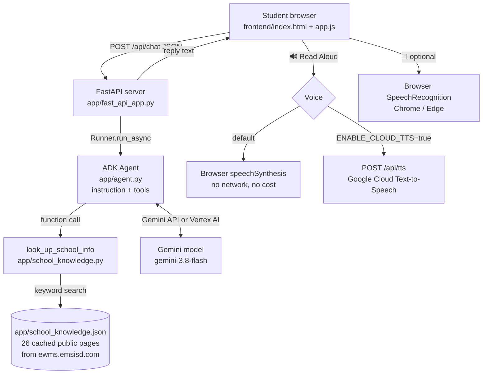
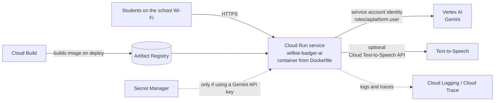

# Architecture (technical version, for the presenter)

The student-facing picture is `docs/architecture-student.svg`. This page is the
accurate version.

## Runtime flow



### Grounding design

* Every school question triggers the `look_up_school_info` tool (the instruction
  says "ALWAYS call" it). The tool returns the best matching cached pages plus a
  fixed block of quick facts and a note telling the model what to do when the
  answer is missing.
* The instruction forbids using memory for school facts and gives the exact
  fallback sentence. Scenario 6 in `tests/` and `scripts/career_day_check.py`
  verifies it.
* General technology / career questions do not use the tool and are answered
  from the model's general knowledge, framed as non-official.
* Sessions are in-memory only (`InMemorySessionService`); nothing is persisted.

## Google Cloud deployment (the "Cloud Architect" view)



| Resource | Why it exists | Show in console |
|---|---|---|
| **Cloud Run** service `willkie-badger-ai` | Hosts the container (web page + agent). Scales to zero when nobody is using it, so it costs almost nothing between demos. | Cloud Run → Services → the service → *Metrics*, *Revisions*, *Logs* |
| **Vertex AI (Gemini)** | The model that writes answers. Called over an API from the agent. | Vertex AI → *Model Garden* (Gemini) and *Dashboard* request counts |
| **Service account** + IAM role `roles/aiplatform.user` | The app's identity. No API key is stored anywhere when using Vertex AI. | IAM & Admin → *Service accounts* |
| **Artifact Registry** + **Cloud Build** | `agents-cli deploy` builds the Dockerfile into an image and stores it here. | Artifact Registry → repositories; Cloud Build → *History* |
| **Cloud Logging / Cloud Trace** | Lets you show a real request flowing through the system after a student asks a question. | Logging → *Logs Explorer*, filter by the Cloud Run service |
| **Cloud Text-to-Speech API** *(optional)* | Better voice for Read Aloud. Needs the API enabled and `ENABLE_CLOUD_TTS=true`. | APIs & Services → *Enabled APIs* |
| **Secret Manager** *(only if you deploy with a Gemini API key instead of Vertex AI)* | Keeps the key out of code and config. Mounted into Cloud Run with `agents-cli deploy --secrets GEMINI_API_KEY=gemini-api-key:latest`. | Security → *Secret Manager* |

Not used on purpose: databases, user accounts, Kubernetes, CI/CD pipelines,
analytics. None are needed for a Career Day demo.

### Deploy commands

```bash
gcloud auth login
gcloud config set project YOUR_PROJECT_ID
gcloud services enable run.googleapis.com aiplatform.googleapis.com \
    cloudbuild.googleapis.com artifactregistry.googleapis.com

# Builds the Dockerfile with Cloud Build and deploys to Cloud Run.
agents-cli deploy --region us-central1 \
    --env-vars GOOGLE_GENAI_USE_VERTEXAI=TRUE,GOOGLE_CLOUD_PROJECT=YOUR_PROJECT_ID,GOOGLE_CLOUD_LOCATION=us-central1
```

`agents-cli deploy` reads `agents-cli-manifest.yaml` (deployment target
`cloud_run`) and runs `gcloud run deploy` under the hood. The Cloud Run service
account needs `roles/aiplatform.user`. To enable the cloud voice, also run
`gcloud services enable texttospeech.googleapis.com` and add
`ENABLE_CLOUD_TTS=true` to `--env-vars`.

If the deployment is not ready on the day, run locally with `make dev`; the
local demo is the primary plan.

## Repository map

```
app/agent.py                 the agent: model + instruction + tool   <- SHOW THIS FILE
app/school_knowledge.py      keyword search over the cached pages
app/school_knowledge.json    the cached public pages (the "library")
app/fast_api_app.py          web server: /, /api/chat, /api/tts, /api/health, /dev-ui
frontend/                    the chat page (HTML, CSS, JS)
tests/unit/                  tests that need no API key (scripted model)
tests/eval/                  dataset for `agents-cli eval run`
scripts/career_day_check.py  runs the six Career Day questions live
scripts/refresh_school_knowledge.py  optional: re-download the public pages
docs/                        diagrams and presenter notes
Dockerfile, agents-cli-manifest.yaml  Cloud Run deployment
```
